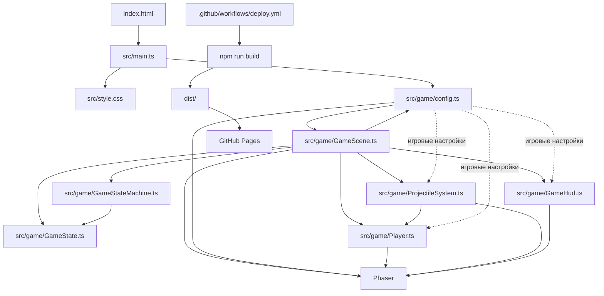

# Контекст проекта для AI-агентов

Этот файл — краткая карта репозитория для быстрого входа в задачу. Он описывает
текущую реализацию, а не желаемую будущую архитектуру. Если описание расходится
с исходниками, исходники являются источником истины.

## Проект за минуту

- Небольшая браузерная аркада: игрок вращает квадрат со щитом, отбивает снаряды
  и набирает очки.
- Стек: TypeScript (strict), Phaser 4, Vite. Backend, база данных и сеть игре
  не требуются.
- Точка входа: `index.html` → `src/main.ts` → `src/game/config.ts` →
  Phaser-сцена `GameScene`.
- Основная координация кадра и событий: `src/game/GameScene.ts`.
- Игровые правила и значения баланса: `src/game/config.ts`.
- Документация по управлению AI-агента: `AGENTS.md`; дополнительные правила
  Copilot при наличии находятся в `.github/copilot-instructions.md`.

## Граф файлов и зависимостей

Стрелка `A --> B` означает, что `A` импортирует или запускает `B`.



### Важная особенность импортов

Сейчас есть циклическая зависимость: `config.ts` импортирует `GameScene`, чтобы
зарегистрировать сцену в Phaser, а `GameScene.ts` импортирует игровые константы
из `config.ts`. Это существующая особенность проекта. Не меняй схему запуска
между этими файлами случайно; если устраняешь цикл, проверь `npm run build`.

## Карта исходников

| Файл | Ответственность | Что обычно менять |
| --- | --- | --- |
| `index.html` | HTML-контейнер `#game`, подключение Vite entrypoint | Разметку страницы |
| `src/main.ts` | Подключает CSS и создаёт игру через `createGame('game')` | Только точку входа |
| `src/style.css` | Стили страницы вокруг Phaser canvas | Оформление страницы |
| `src/game/config.ts` | Phaser config, создание игры, фазы и игровые константы | Баланс, цвета, размеры, скорость |
| `src/game/GameScene.ts` | Инициализация модулей, ввод, порядок обновления, игровые события | Координацию механик |
| `src/game/GameState.ts` | Тип режима и изменяемые данные одной игровой сессии | Новые игровые данные/режимы |
| `src/game/GameStateMachine.ts` | Разрешённые переходы, пауза и возврат из паузы | Правила переходов режимов |
| `src/game/Player.ts` | Контейнер игрока, вращение и проверка направления щита | Поведение игрока |
| `src/game/ProjectileSystem.ts` | Спавн, движение и столкновения снарядов | Поведение снарядов |
| `src/game/GameHud.ts` | Счёт, прогресс фазы, предупреждение, пауза и поражение | Игровой интерфейс |

## Поток одного кадра

1. `GameScene.update(time, delta)` проверяет поражение и ввод паузы.
2. В режиме `paused` обновление останавливается; после продолжения FSM
   восстанавливает `playing` или `warning`.
3. В режиме `warning` уменьшается таймер предупреждения; по его окончании FSM
   возвращает `playing`.
4. `Player.rotate(...)` применяет ввод стрелок или A/D.
5. `ProjectileSystem.update(...)` создаёт снаряды только в `playing`, но
   продолжает двигать уже созданные снаряды и во время `warning`.
6. Блок щитом вызывает обработчик в `GameScene`: увеличивается счёт и
   обновляется HUD. Попадание мимо щита переводит FSM в `gameOver`.
7. При достижении порога очков `GameScene` переключает фазу, показывает
   предупреждение и запускает встряску камеры.

## Состояния

| Текущее состояние | Событие | Следующее состояние |
| --- | --- | --- |
| `playing` | порог очков для новой фазы | `warning` |
| `warning` | закончился таймер предупреждения | `playing` |
| `playing` или `warning` | P / Esc | `paused` |
| `paused` | P / Esc | сохранённое до паузы состояние |
| `playing` или `warning` | попадание в игрока | `gameOver` |
| `gameOver` | пробел | сцена перезапускается с новым состоянием |

`gameOver` — терминальное состояние FSM до перезапуска сцены.

## Управление и правила игры

- Стрелки влево/вправо или `A`/`D`: вращать игрока и щит.
- `P` или `Esc`: пауза / продолжение.
- `Space`: перезапуск после поражения.
- Щит блокирует снаряд в пределах углового сектора; успешный блок даёт очко.
- Следующая фаза выбирается по `scoreFrom` в `PHASES`.
- Параметры баланса находятся в `src/game/config.ts`; не дублируй их магическими
  числами в логике.

## Команды и публикация

Из корня репозитория:

```bash
npm run dev       # локальный сервер разработки, обычно http://localhost:5173
npm run typecheck # проверка TypeScript
npm run build     # typecheck + production build в dist/
npm run preview   # локальный просмотр production build
```

`.github/workflows/deploy.yml` запускает `npm run build` и публикует `dist/` на
GitHub Pages при push в `main` или `master`.

## Правила работы AI

1. Сначала прочитай этот файл и корневой `AGENTS.md`, затем открой исходник,
   который относится к задаче.
2. Сохраняй небольшой учебный браузерный проект и текущий TypeScript strict.
3. Делай минимальное изменение по задаче; не добавляй backend, зависимости или
   новые архитектурные уровни без явной необходимости.
4. Если добавляешь игровой режим, обнови `GameMode`, переходы FSM, эту карту и
   схему `architecture.svg`.
5. После изменения игровой логики запусти `npm run typecheck` и, если возможно,
   `npm run build`.
6. Синхронно обновляй эту карту, `README.md` и `architecture.svg`, когда
   действительно меняются архитектура, управление или ключевые потоки.
